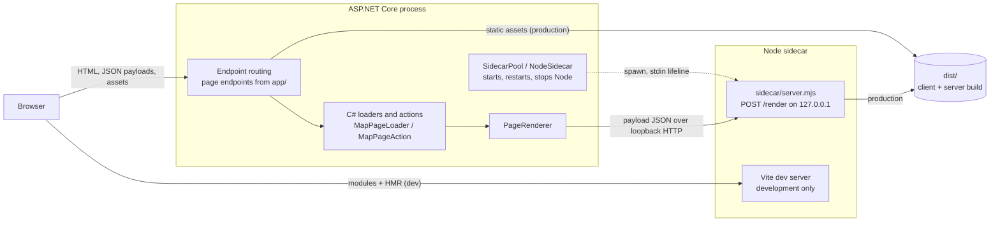
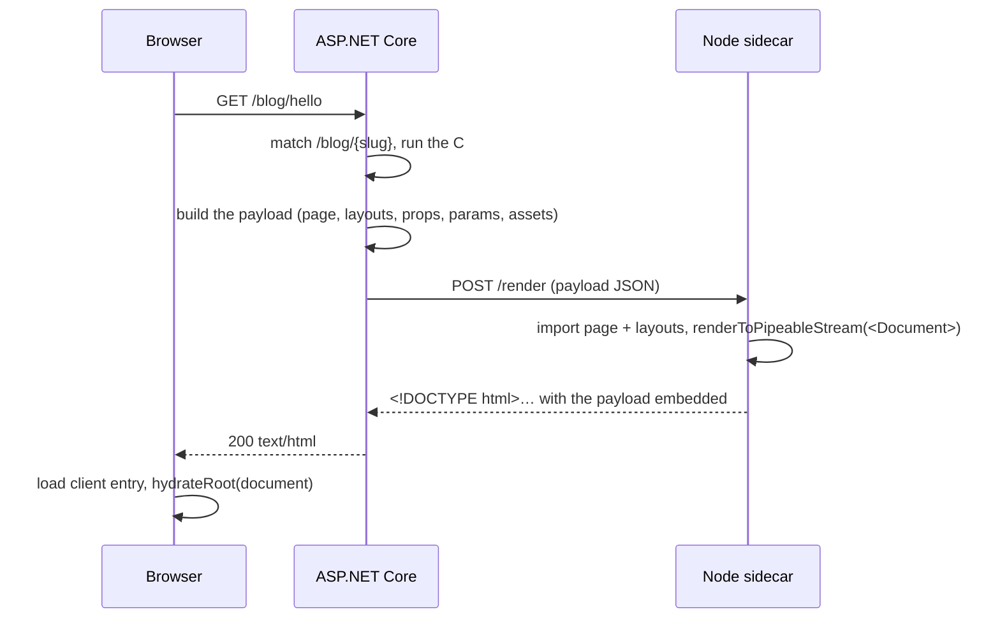
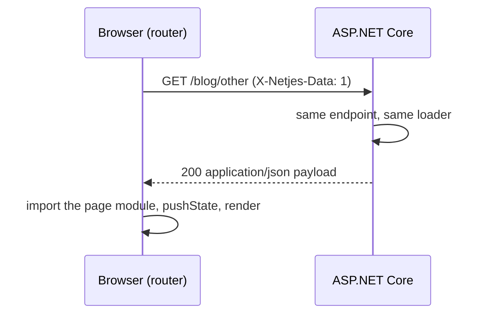
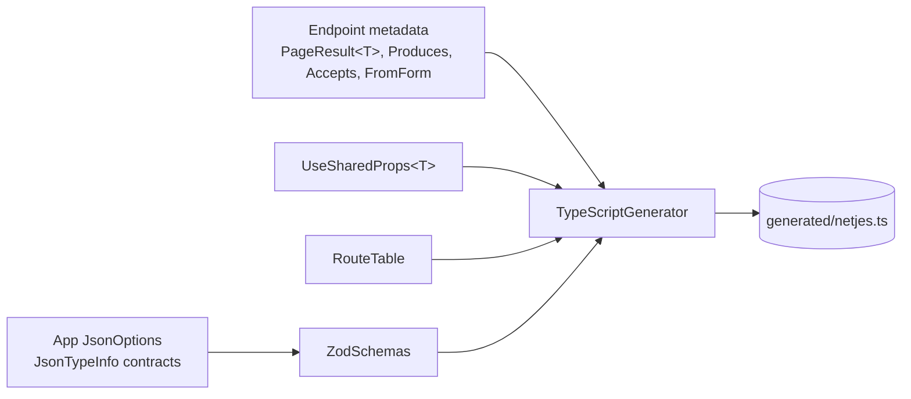

# Architecture

This page is for people who work on Netjes itself. It explains how a request, a client navigation and a server action travel through .NET, the Node sidecar and the browser, how the parts are built, and where they live in the code. How to use each feature is in the [guides](README.md); why it is built this way is in the [decisions](#decisions).

Netjes is a React page framework hosted by ASP.NET Core. .NET owns the request: it matches the URL against routes derived from the files in `app/`, runs the page's C# loader or action, and decides the response. Rendering React to HTML needs a JavaScript engine, so Node processes (the sidecar) run next to the app and turn a page payload into a complete HTML document. In the browser, a small client router hydrates that document and handles later navigations by asking .NET for the next page's payload as JSON.

## Containers



In development the sidecar also hosts the Vite dev server: the browser loads modules and receives HMR updates from it (port 5173), and the sidecar renders with `ssrLoadModule`, so edits show up on the next request. In production the sidecar imports the prebuilt `dist/server/server-entry.js`, and .NET serves `dist/client` as static files. `NetjesOptions.SidecarProcesses` runs several sidecars in production; `SidecarPool` sends each render to the least busy ready one and keeps a streamed render's deferred values on the process rendering it ([ADR 0001](decisions/0001-react-renders-in-node-sidecars.md)).

## The sidecar pool

`NodeSidecarHostedService` starts the pool with the host, unless the app replaced `ISsrRenderer` or runs a command that renders nothing (`generate`, `routes`). Each `NodeSidecar` launches `node` with its script and settings in the environment (`NETJES_MODE`, `NETJES_ROOT`, `NETJES_TOKEN`, `NETJES_VITE_PORT`, `NETJES_SERVER_ENTRY`, `NETJES_RENDER_TIMEOUT_MS` and `NETJES_STREAM_TIMEOUT_MS`; `NETJES_VITE_HOST` and `NETJES_VITE_ORIGIN` pass through from the app's own environment), and waits for the process to print `NETJES_READY` with its port, within `StartupTimeout`. In development, a process whose Vite dev server does not start prints `NETJES_FAILED` instead, and exits: `vite-port-in-use` with the port when something else has it, or `vite-failed` with Vite's message (as plain text) and the error's code for anything else, such as an error in `vite.config.ts`. Its start then fails with a `VitePortInUseException` that names the port and the setting that moves it, or a `ViteDevServerFailedException` with what Vite reported and what to do (`npm install` for `ERR_MODULE_NOT_FOUND`, or `MODULE_NOT_FOUND` from a CommonJS config). The process listens on `127.0.0.1` on a port of its own choosing, answers only requests that carry its token (`X-Netjes-Token`), and exits when its stdin closes, which ties its life to the .NET process.

### Startup failures

`VitePortInUseException`, `ViteDevServerFailedException`, a `node` that cannot be launched, a sidecar script that is not there and a missing production build are `NetjesStartupException`s: their message says what is wrong and what to do, so the app reports them as one critical log entry, without the stack, and exits with code 1 ([ADR 0018](decisions/0018-startup-failures-end-in-one-line.md)). That is for an app that is the program its process runs, which `NetjesContext.IsTheProgram` tells from the host's application name: it is the entry assembly's unless set otherwise, and `WebApplicationFactory` gives the app its own name in the test runner's process. `NodeSidecarHostedService` keeps the failure rather than throw it, so the host does not log it with its stack and `Run()` does not throw it again. Once the host has started, it sets exit code 1 through `CommandExit` and stops the app (stopping during the start would cancel the server's start, which fails the same way), and it logs the message as the host stops, after the host's own messages. `PendingStartupFailure` holds the failure meanwhile, so that the export leaves it alone. A missing production build is thrown from `UseNetjes()`, in the app's `Program.cs`, before the host starts: `UseNetjes()` still throws it, and registers a handler for the process's unhandled exceptions that, for that exception only, logs the message, disposes the logger providers so the console logger writes it, and exits with code 1 before the runtime prints anything. In any other process, as a test host's, the start fails with the exception. A host that a test builds itself with `WebApplication.CreateBuilder` has the test assembly's name, which is the entry assembly's, so it stops rather than throw: the tests of `NodeSidecarHostedService` replace `CommandExit` to read the exit code it sets.

### Restarts

A sidecar that crashes is restarted with backoff (`RestartPolicy`): after 1 s, doubling with each crash in a row up to 30 s, and back to 1 s once a process has stayed up for 30 s.

Until .NET reports the exit, the process still counts as ready, so a request can pick it after its port has closed. Such a request never reached the process: it found it exited, or its connection was refused or reset while connecting (.NET reports those as a `ConnectionError`, or throws the socket error bare from its connect step). The request takes the process out of the ready ones, as the exit handler does as soon as .NET reports the exit, with a warning in the log, and the health check counts it as restarting. The exit handler then waits up to two seconds for the process's output to end (a child it left running can hold it open for as long as that child lives), logs the exit with the last lines the process printed, and schedules the restart.

The request goes out once more, to whatever is ready next. With one process that is the restart. In the pool, a render without deferred values goes to the next pick, another ready process if there is one, and so does one whose pick stopped counting as ready before the render was sent; if that one fails the same way, its own second attempt waits for what is ready next there, so a render makes at most three attempts. A render with deferred values stays on its process, where its values are sent, and waits for its restart. Other errors while connecting, such as running out of local ports, say nothing about the process: the request fails and the process stays ready.

Nothing that was written to a process is sent again. When a process dies, the connections still waiting in its accept queue are reset, and their requests have already been written: .NET reports them as failing while sending, as it does for a render the process read before it died, and they fail. With `SidecarProcesses` at 1, that is every render queued behind a synchronous render that crashes the process. They are not sent again because the render that crashed it can be among them: sent again, it would take down the restart, or another healthy process in the pool.

A render waiting for a restart does so within its own `RenderTimeout` (15 s; `StreamTimeout` for a complete document), then fails with "The Node sidecar was not ready to render within 15s: it is restarting." From the fifth crash in a row the backoff (16 s, then 30 s) is longer than that, so on a process that keeps crashing, a render with deferred values (with one process, any render) can time out before the process comes back.

A process that was taken out and is still running two seconds later counts as ready again. That is for Windows, where a full accept queue refuses connections: a process too busy to accept sits out for two seconds, counted as restarting, so the health check reports Unhealthy with one process and Degraded with more. Renders on that process wait for it, and one refused again after that fails. A shorter grace costs more than it saves: a crash .NET has not noticed by then is handed back to the renders waiting for its restart, and their last attempt fails on it.

### The client-rendered fallback

With no process ready at all, a document request in production does not wait for one ([ADR 0013](decisions/0013-client-rendered-fallback.md)). `PageRenderer` finds the pool's ready set empty as it is about to render, and writes the document itself (`ClientRenderShell`): the head `Document` renders, with the title, description and robots from C#, and a body with only the payload, marked `document.clientRender`. Loaders, authorization and the status run first as always, so not-found and error pages arrive the same way with their status, and redirects are unchanged. `Page.Defer` values follow as the `__netjes_d` scripts a streamed document carries, for at most `StreamTimeout`. The client entry calls `createRoot(document)` instead of `hydrateRoot`: React keeps the shell's scripts and stylesheets and replaces the rest, and `Document` leaves the bootstrap out, as the shell already ran it.

Each fallback logs a warning and counts on `netjes.sidecar.fallbacks`. The output cache never stores it, and `NoStore.Force` sends it `Cache-Control: no-store` in place of any header the page set, as it does draft pages and draft redirects, the page for a failed form post, action answers and antiforgery tokens. `NoStore` also removes the headers a CDN or proxy reads ahead of `Cache-Control` (every name ending in `-Cache-Control`, `Surrogate-Control`, `Edge-Control`, `X-Accel-Expires`), and does both again as the response starts: `UseNetjes` registers that callback before routing, so it runs after the `OnStarting` callbacks of loaders, actions and later middleware ([ADR 0019](decisions/0019-forced-no-store-removes-cdn-cache-headers.md)).

The shell's head is .NET's copy of `Document`'s, kept in step by two tests: `ClientRenderFallbackTests` pins the shell of a fixture page in `packages/netjes/test/fixtures/client-render/shell.html` (`UPDATE_GOLDEN=1` rewrites it), and `client-render-shell.test.tsx` renders that payload with `Document`, as a sidecar would, and compares the heads element by element, nonces included.

Only the moment of the render counts: a render that went to a process and then fails keeps its error page, as it may be what brought the process down. Development, whose sidecar also runs the Vite dev server, and commands such as export never fall back. `NetjesOptions.ClientRenderFallback = false` turns it off. The user-facing behaviour is in [rendering and streaming](guides/rendering-and-streaming.md#when-no-sidecar-is-ready).

### Shutdown

`NodeSidecarHostedService` stops the pool it started when the host stops. Each sidecar closes its process's stdin, which asks the process to exit, and kills it and its children if it is still running three seconds later. Nothing restarts once a stop has begun.

A sidecar stops once, however often it is asked: a host can be stopped twice at once and disposed as soon as one of those stops returns (`WebApplicationFactory` does this to an app with minimal hosting), so later stops and the dispose wait for the stop in progress, and the dispose lets go of the process only after it. The hosted service keeps the pool it started, so a stop that gets there after the container was disposed still finds it.

A sidecar launches one process, however often it is started: only the first `StartAsync` launches, and a later call, or one at the same time, waits for that process (or its restart) as the first does, or fails as the first did. A second launch would replace the process that renders and restarts look after, and leave it running. A sidecar does not start again once a stop has begun, the dispose's included: every later stop waits for that one, which ends only the process it found. `StartAsync` then throws an `InvalidOperationException` ("The Netjes Node sidecar has been stopped; it cannot be started again.") and launches nothing. The pool disposes its sidecars together, as it stops them, so a host disposed without being stopped first waits out one grace for all its processes, not three seconds for each.

Killing a process tree can fail part way, when a process in it may not be signalled. The stop then fails with that error, which the host reports. Disposing the sidecar does not throw it: the dispose logs it as a warning, `Stopping the Node sidecar {Pid} failed: {Message} It, or a process it started, may still be running.`, and lets go of the process and the sidecar's HTTP client regardless, and the pool goes on to dispose its other sidecars. A host that is stopped before it is disposed, as `app.Run()` does, reports the failure twice: once from the stop and once from the dispose.

## A first request



## A client navigation



The same endpoint serves both: the `X-Netjes-Data` header selects JSON over HTML, and responses carry `Vary: X-Netjes-Data, X-Netjes-Segments`. Redirects come back as `{ kind: "redirect" }` payloads, which the router follows. If the payload names a page this client build does not contain, or comes from a different build (`version`), the router falls back to a full page load. So does an answer that is not a Netjes payload (a static host's HTML file, say) to a `GET`, and a page module whose import fails: the client entry's module loader rejects with a `ModuleLoadError` that names the file and says why (the browser's error, which is its `cause`), and forgets the failure, so the next load imports the module again. The server's loader rejects with the module's own error, a syntax error or code that needs the browser, so the sidecar logs its message and stack. The document the browser then loads handles its own first page, so a module that never loads costs one full page load and no loop.

The client entry handles a failed import on the first page itself, since no router is running yet to fall back. It imports the page's modules once more after 500 ms, and the browser fetches a module again after a failed dynamic import. If that fails too, it logs one error naming the module and renders nothing: the server's HTML stays as it is, unhydrated, so links and forms are plain HTML until the next full page load. It does not reload the document, as Vite suggests doing on its `vite:preloadError` event: a chunk that is gone for good would reload it again and again. The client-rendered fallback has no page HTML to keep, so it stays blank, and the error says the page cannot render.

### What the router keeps

The router keeps the last 50 pages it showed, one per history entry, and shows them again on Back and Forward without a request; prefetched payloads are kept for 30 seconds and dropped after every action.

A server action call or form post whose response sets or deletes a cookie makes it forget both, like Next.js, where cookies an action sets invalidate the client router's cache ([ADR 0014](decisions/0014-signing-in-or-out-clears-what-back-shows.md)). Script cannot read `Set-Cookie`, so the server marks such a response `X-Netjes-Cookies: changed`: `CookieChanges`, an endpoint filter on `MapAction` and `MapPageAction`, registers an `OnStarting` callback when the call starts and compares the `Set-Cookie` values then with those already there. Callbacks run in reverse order of registration, so the action's own callbacks have written their cookies by then, and those registered before the endpoint (cookie authentication's sliding renewal, the session cookie) write theirs after. The antiforgery cookie, by its configured name as browsers parse it, does not count on its own, and posts without JavaScript are not marked.

The router acts as soon as it sees the header, before it follows a redirect or reads the body. Requests still on their way went out with the old cookies: the navigation on its way is aborted and started again, and its promise (`router.push`, or the refresh an action awaits) ends with the new attempt; every prefetch in flight is aborted and started again too, and the refresh after the call or the post that follows keeps those (a revalidation the action asks for drops them, as after any action). A form post is never sent twice: when another call's header arrives while it runs, its answer is shown as it came. Until a page comes from the server again, the router keeps the page on screen for no history entry, not even one a fragment link on it adds.

After a `MapAction` call that changed cookies, the router loads one page from the server, as Next.js does: the action's redirect, or its revalidation, or else a refresh of the page on screen, which a redirect to a fragment of that page needs too, since it loads nothing. A redirect to another site, which the browser loads instead, is not followed by a refresh, and neither is one that ends in a download. A refresh (`router.refresh()` too) replaces the page in its own history entry and keeps the URL's fragment, without scrolling. When the user moved on while the action ran to a page that loaded meanwhile (React holds it until the action is done), that page is refreshed instead; one still loading has started over already. A fragment link followed before the refresh arrives supersedes it, as it supersedes any navigation, and the page stays as it was until the user leaves it.

The query shell clears its `QueryClient` on the same header ([Server state](#server-state)). The pages' `Cache-Control` decides what the browser keeps itself ([Runtime configuration, draft mode, CSP](#runtime-configuration-draft-mode-csp)).

Only the tab that made the call sees the header, and the app's other tabs send the same cookies, so the router tells them ([ADR 0021](decisions/0021-signing-in-or-out-reaches-the-other-tabs.md)). It opens a `BroadcastChannel` named `netjes:` and the base path (`netjes:/` at the root) when it starts, in the same layout effect that listens for back and forward, and posts `cookies-changed` on it whenever it sees the header. A router that gets that message forgets what the header makes the sending tab forget, its fetched antiforgery token included, starts over what is on its way, clears its query cache through the same `onCookiesChanged` listeners, and refreshes the page on screen with the prefetches it started over kept, unless a navigation it started over or a form post is on its way: the post's answer is shown as it came, as in the tab that made the call. It never posts on a message, and a channel does not receive its own, so the tabs never answer each other: one change costs every other tab one request. A router that hands its tab to a document a form post answered closes its channel, as does one that unmounts. Without `BroadcastChannel` nothing is posted, and the other tabs keep their memory and query cache; the layout keys still load their layouts again on their next click.

### Origins

The payload's `url` is the request's path and query. The router reads it as a path on the document's origin, also when it starts with `//` (a request for `https://app//other.example/x`), and fetches page payloads from that origin only: a link or redirect to another origin is a full page load, and a payload `url` on another origin is never used: the router loads that page as a document instead, or, for the first page, goes by the browser's location.

## Routing

`RouteTable.Build` (C#) is the single implementation of the file conventions: the Next.js App Router's, in `app/` (`page.tsx` files, with segment files per folder). There is no pages router ([ADR 0010](decisions/0010-app-router-with-csharp-layout-loaders.md)); `UseNetjes` stops an app that has Next.js pages router files in a `pages/` folder (`PagesFolder`), naming an `app/` file for each, and the API routes in `pages/api/` to map as minimal API endpoints, so they cannot answer 404 without a word. Each page has a chain of segments, the folders above it with a layout, template, loading, error, not-found, forbidden or unauthorized file.

In development the files come from scanning `app/` and are rescanned on change (`FileSystemRouteTableProvider`); in production they come from the keys of the Vite client manifest (`ManifestRouteTableProvider`), so routes match what was built. Two pages of one shape (`[lang]/about` and `[slug]/about`, the same pattern but for parameter names), or two files for one convention in one folder (`page.tsx` and `page.jsx`), are a `RouteConflictException` naming both: otherwise the one listed last would win, and the scan and the manifest list files in different orders. A file name the conventions do not allow is an `InvalidPageFileException`. The client build takes only the convention files, so a route handler (`route.ts`) would never reach the manifest: the Vite plugin stops `vite build` on one itself, with the route table's message, following the same rules (tests, private folders and slots aside). `MapPages` reads the route table, so either one stops the app at startup in every mode. The manifest provider builds its table when it is first read, and the matcher reads the pages' endpoints for every request, so left to the first request the exception would fail every request of the app, `/healthz` included. A rescan that finds one logs it and keeps the previous routes.

Loaders and actions are checked as they are mapped. ASP.NET Core infers how a handler binds when it first builds the endpoints, on the first request, and an endpoint it cannot build fails that build, so every request of the app would answer 500; a layout loader's request delegate is built on the first request of its section, which would fail every request of the section. So `MapPageLoader`, `MapLayoutLoader`, `MapPageAction` and `MapAction` run `RequestDelegateFactory.InferMetadata` with the options the endpoint's request delegate is built with (the route parameters of its pattern and of the prefixes of the route groups it is mapped in, or of the layout's URL; no inferred body for a loader, as for a GET endpoint; an inferred body for an action, as for a POST one) and throw an `InvalidOperationException` that names the page or layout file and its URL, or the action, with minimal APIs' reason. ASP.NET Core keeps a route group's prefix to itself until it builds the endpoints, so it is read from the private fields of `RouteGroupBuilder`; should they ever not be there, the check passes no route parameter names, and minimal APIs check a `[FromRoute]` name when they build the endpoint. `MapAction` and `MapPageAction` also refuse a `[FromForm]` input that form binding could never build: it builds a class, struct or record only through its one public constructor, never an abstract class or an interface, and binds `null`, without an error, for a type with several, a class with none or an abstract type, whether that is the input itself, the type of a property it fills or a list's items. Both also read the DataAnnotations of the action's inputs, which its validation filter would otherwise read while the endpoints are built, so an attribute that cannot be read (a `[Display]` whose resource type has no such name, an attribute whose constructor throws) stops the app too, naming the action, the parameter and the property. They read those of the derived types an input lists with `[JsonDerivedType]` as well, which the filter would read on the first call that sends one. A loader parameter minimal APIs would read from the request body (a complex type that is not a registered service, has no binding attribute and does not bind itself) gets a message of its own, naming the parameter, its type and the fixes that fit the type: `[AsParameters]`, a static `BindAsync` or, for a class, registering it as a service; a service first for an interface, an abstract type or a type of .NET; for a collection, the array that binds from repeated query string values. To find it, each top-level parameter's type is put to minimal API binding on its own, and an `[AsParameters]` member is found by inferring once more with a body allowed, which names the body's type, so the type rules stay those of minimal APIs. A loader that binds but reads the request body all the same, through a `[FromBody]` or `[FromForm]` parameter or a form, a file or files (`IFormCollection`, `IFormFile`, `IFormFileCollection`), at the top level or as an `[AsParameters]` member, stops the app too: minimal APIs bind those on a GET endpoint as well, and a navigation carries no body, so the page would answer its not-found page and a layout loader would fail every page below the layout. Whether a loader reads a body is taken from what minimal APIs infer for it: the accepts metadata (`IAcceptsMetadata`) they add for a body or a form. Form fields and files share one entry, so the parameters are named by the attributes and types minimal APIs read from the body. Accepts metadata without a parameter that reads the body comes from a type that adds it for itself (`IEndpointParameterMetadataProvider`, `IEndpointMetadataProvider`), a parameter's or the result's. It changes nothing for a layout loader, whose delegate is called while the page renders, but a page loader with it stops the app, naming the parameters whose types add it, found by putting each type to minimal API binding on its own: routing sends a request without a Content-Type to an endpoint without accepts metadata when one matches the URL, and the not-found fallback matches every URL, so no navigation would reach the page. A loader parameter without a binding attribute whose type is a collection interface of .NET of values that bind from a string (`IEnumerable<int>`) stops the app as well when the service container supplies that interface whether or not it is registered: minimal APIs bind it from services, an empty one, and never from the query string, which the array of those values (`int[]`) binds from. Which interfaces the container supplies unregistered is asked of `IServiceProviderIsService` with an element type no app registers: Microsoft's container supplies `IEnumerable<T>`, and some others the list interfaces too. A collection interface the container does not supply on its own binds from services when it is registered as one (`IReadOnlyList<string>`); an `IEnumerable<T>` meant as a service needs `[FromServices]`, as the message says.

Each page becomes a `RouteEndpoint` with an ordinary ASP.NET Core template (`[slug]` → `{slug}`, `[...path]` → `{**path:minlength(1)}`, `[[...path]]` → `{**path}`), so the matcher decides precedence. Pages with a C# loader are mapped by `MapPageLoader` and skipped by the file data source (`PagesEndpointDataSource`). A lowest-priority `{**path:nonfile}` endpoint renders the 404 page. Literal segments match in any case, but route values reach loaders as sent, so the output cache keys entries on the exact path (ASP.NET Core's default key upper-cases it unless `UseCaseSensitivePaths`).

### Two watchers in development

In development two watchers follow `app/`, independently. .NET's (`FileSystemRouteTableProvider`) rescans as soon as a file changes. Vite builds the page module map (`virtual:netjes/pages`, an `import.meta.glob` of the convention files, which the server entry and the client entry import) again once its watcher reports a page file added or removed. Either can be first. Vite's watcher reports a new file a few milliseconds after it is written, hundreds on a loaded machine, and it can miss one: it reads a new folder before it starts watching it, so a file created in between is not reported until something else in that folder changes (the file is saved again, say), and it never watches some folders at all (`test-results/`). Until Vite next builds the map, for this file or another, the server entry the sidecar evaluated holds the old one and cannot load a page .NET already routes.

In development, therefore, a render that fails with `MissingModuleError` asks the Vite plugin to build the map again from the files on disk, for the server and for the browser, and runs once more. A file still missing after that one scan (outside `app/`, or deleted since) fails. A deleted page file is the other way round: .NET stops routing it when its rescan runs, and until then a request for it renders the copy Vite still holds, or fails once Vite has dropped it. That window is short with .NET's default watcher; with `DOTNET_USE_POLLING_FILE_WATCHER`, which the development Docker images set, .NET polls every four seconds. In production the routes and the module map come from one build and nothing is scanned again, so the sidecar fails at once.

### Route warnings

`RouteDiagnostics` checks the routes once the app has started, in every mode, and logs a warning for each finding; the routes command puts them in its report (`warnings`) instead, and the CLI prints them after the table. A failing check is logged and skipped, never a reason to stop. It checks the routes as they are at startup, so pages added while a development server runs are checked on its next start. There is no option to turn it off: the warnings go to the `Netjes.Routing.RouteDiagnostics` logger, whose log level hides them. There are three checks (why only these, and only when likely wrong: [ADR 0015](decisions/0015-route-warnings-name-what-is-likely-wrong.md)); what they report, and how to silence each, is in the [routing guide](guides/routing.md).

- Loader parameters. It reads the binding minimal APIs inferred, rather than repeating their type rules: the `IParameterBindingMetadata` on a page loader's GET endpoint, and for a layout loader `RequestDelegateFactory.InferMetadata` with the options of its own request delegate (whose route parameters are those of its segment's URL). It applies minimal APIs' order to those: binding attributes, then types that bind themselves (`BindAsync`), then strings and `TryParse` types, which take the route value when the pattern has a parameter of that name in any case and the query string otherwise. Arrays of them count as query parameters: page loaders are GET endpoints, and layout loaders are built without an inferred body, as those are. A top-level parameter that binds from the query string while some route parameter is bound neither by the loader nor by a layout loader of a segment above it is a warning (an `[AsParameters]` member that binds it counts, but members are never named themselves). The layout loaders above a page are those of its segments, the page's own folder included; for a layout loader, those of the folders above its own. When some query parameters have a near name of an unbound route parameter (a Levenshtein distance of two or less, ignoring case), each gets a warning naming that pair; otherwise the loader gets one warning listing every query parameter and every unbound route parameter. A layout loader's top-level query parameter whose name, in any case, is that of a route parameter of a page below the layout, and not of the layout's own URL, gets a warning of its own naming the first such page in pattern order; it is taken to be meant for that route value, so the warning about the layout's own unbound route parameters leaves it out. It never meets a loader whose binding minimal APIs refuse: mapping one stops the app (above).
- Overlapping pages. Every pair of pages is compared on its file pattern, matched as ASP.NET Core matches the templates: literals in any case, `[x]` one segment, `[...x]` one or more (its `minlength(1)`), `[[...x]]` any number. The winner of an overlapping pair is the endpoint with the lower order, then the lower `RoutePattern.InboundPrecedence`, so the warning names what the matcher does. A pair is left out when the winner matches only URLs the other matches too and the first segment where they differ is a literal in the winner (`/blog/new` and `/blog/[slug]`, `/about` and `/[...slug]`): a static segment carving an exception out of a dynamic one is the convention. Everything else that overlaps is a warning: a parameter next to a catch-all (`/[id]` and `/[...rest]`), a page next to an optional catch-all of its own URL (`/docs` and `/docs/[[...slug]]`), different parameter names at one position (`/[lang]/about` and `/[slug]/[page]`), and literals in different places (`/en/[slug]` and `/[lang]/about`).
- Form inputs. For each server action (`ServerActionMetadata`) and page action (a page's POST endpoint), the `[FromForm]` parameters that form binding builds from fields (`EmptyFormInputs.IsFormObject`) are looked at through the constructor form binding uses when the type has no parameterless one: its only public constructor. A constructor parameter of type `bool`, `bool?`, an array or another `IEnumerable<T>` but `string` is a field a browser leaves out of the post when nothing is checked or chosen, and form binding refuses a post that lacks any constructor parameter, so the type gets one warning naming those parameters. Text fields are not named, since a browser posts them even when empty.

### Parallel and intercepting routes

`@slot` folders belong to the segment of their parent folder (`RouteSegment.Slots`), not to the routes. For each request the server names the file each slot renders, the slot's page at the route's pattern below the segment or its `default.tsx`, in the segment's payload (`slots`), and the client passes each one to the layout as a prop. Unlike Next.js, a slot without a match renders its default (or nothing) on client navigations as well.

Intercepting routes are `(.)`, `(..)` and `(...)` folders inside a slot. The route table records the URL pattern each intercepts (`RouteTable.InterceptsFor`); a data payload lists them (`intercepts`), and the client router, on a soft navigation whose current page sits inside the intercept's segment, keeps that page (same key, so its state survives) and renders the intercepting page, with the real page's props, in the slot. Documents never intercept, so a reload shows the real page.

### Layout loaders and segment keys

Layout loaders (`MapLayoutLoader`, `LayoutLoaderRegistry`) run in the page's request, outermost first, before the page renders; their conventions are applied to every page endpoint below them. On client navigations the router sends the keys of the segments it holds (`X-Netjes-Segments`) and the server skips loaders whose key is unchanged (a header over 2 KB, far more than a page's keys, is ignored).

A key is a truncated HMAC, signed with `SegmentKeySecret`, of the segment's folder, the build, the user (authentication type, name, identifier and roles) and the route values of the segment's own URL. Each field is written with its length, or as none, so no value can pass for the next: a route value with a line break (a `%0A` in the path decodes to one) for two route values, a name for a name and an identifier, a role with a comma for two roles.

A layout loader binds only those route values: its request delegate gets the segment's parameters as its route parameter names, and no inferred body, as the page's GET endpoint has none, so arrays and other simple parameters bind from the query string, and a complex type binds only as a service, with `[AsParameters]`, or by itself (`BindAsync`). `MapLayoutLoader` refuses a loader whose `[FromRoute]`, on a parameter or an `[AsParameters]` member, names a route parameter outside the segment's URL (minimal APIs would refuse it on every request), so every route value a loader can bind is in its key. A loader that reads another route value through `HttpContext` or a type that binds itself, or reads the query string or a cookie, depends on something its key does not hold: it keeps what it loaded first while the client navigates within the section, and an access check it makes on that value is skipped there, so such checks belong in the page's loader ([ADR 0010](decisions/0010-app-router-with-csharp-layout-loaders.md)).

The output cache keys a payload by which of the page's layout loaders the client sent a valid key for, one character per loader (`CachedSegments`), and a document by its being one, never by the raw header values: anyone can make those up, and the output cache's `SizeLimit` counts response bodies, not key text. A payload that reuses a segment is also keyed by a fingerprint of `SegmentKeySecret` (a truncated HMAC of a fixed label, never the secret): its keys mean nothing to an instance with another secret, so on a store several instances share, only those with the same secret serve it. Documents and full payloads reuse nothing and are shared by all of them. A render that reused other segments than its key says (an endpoint rendering another route's page, a user set after the output cache ran) is not stored. That includes a page loader's redirect for a client that holds segments: the redirect reuses none, so each such request renders. The key still holds the host and the query string, so production apps pin `AllowedHosts` and size the cache.

These rules hold however a page is output-cached ([Output caching](#output-caching)). A loader that returns `NotFound`/`Forbidden`/`Unauthorized`, or throws, renders the nearest boundary file above the failing segment.

The client never matches routes itself: it asks the server for every navigation and gets the page module path in the payload ([ADR 0002](decisions/0002-server-owns-routing.md)).

## The payload

One JSON shape travels everywhere (`src/Netjes/Rendering/PagePayload.cs` ↔ `packages/netjes/src/payload.ts`): `route`, `page`, `segments`, `props`, `params`, `shared`, `status`, `url`, `version`, `renderedAt`, optional `antiforgery` and `queries` (TanStack Query entries seeded by `.WithQuery`), and for document requests a `document` section with the assets, the error page and the image optimiser's path and widths. It is serialized with the app's JSON options (camelCase), escaped so it can sit inside a `<script>` tag (`HtmlSafeJson`), embedded in the HTML for hydration, and parsed (not cast) on the client.

An output-cached payload is served to every visitor, `shared` included, so `CachePaths` swaps in a request-cookies feature on renders the cache means to store (`CachedRenderCookies`): the first read through `Request.Cookies` (other than draft mode's) while the output cache still holds the request logs a warning once per page, saying the render was stored and will be served to every visitor. The render is stored regardless: refusing would turn caching off for every page behind a middleware that reads a cookie on each request (cookie authentication, `UseSession()`, a cookie culture provider). Reads of the raw `Cookie` header are not seen, so the guard is a warning, not a reason to read cookies on cached pages: `SharedProps` and loaders of cached pages must not depend on cookies, and per-visitor values belong on the client, or the page uncached. `UseAuthentication()` placed after `UseOutputCache()` triggers the warning too, and the default policy then cannot see the user.

## Streaming

```mermaid
sequenceDiagram
  participant B as Browser
  participant A as ASP.NET Core
  participant S as Node sidecar
  B->>A: GET /blog/hello
  A->>A: loaders run; Page.Defer values keep running
  A->>S: POST /render (payload with placeholders, render id)
  S-->>A: shell (loading fallbacks) at onShellReady
  A-->>B: shell, flushed
  A->>S: POST /resolve (render id, d0, value)
  S-->>A: boundary content + <script>__netjes_d("d0", …)</script>
  A-->>B: the rest of the stream
```

`Deferred<T>` serializes as a placeholder (`{ "$netjes": "deferred", "id": "d0" }`) while `DeferredCollector` records the work; once the payload is written, `PageRenderer` waits on each value's task, or starts its work in a DI scope of its own for the `Page.Defer(services => ...)` overload, and delivers it to the sidecar with `POST /resolve` as it completes, for at most `StreamTimeout`. The client entry is an `async` module and the payload is the body's first element, so the browser hydrates the shell as soon as the script loads, while the rest is still streaming; React hydrates each Suspense boundary as its content arrives. Client navigations with deferred values get NDJSON instead: the payload line, then one line per value ([ADR 0012](decisions/0012-streamed-documents-and-deferred-values.md)).

A Suspense boundary whose content is ready when the shell goes out is written in place, so a browser without JavaScript shows it too. React's default differs: once the bytes written so far (the shell, which carries the payload and, in development, the page's CSS) plus the next ready boundary pass `progressiveChunkSize` (12.8 kB), React sends that boundary after the shell in a hidden element and reveals it with an inline script, which would leave a large page without JavaScript, and in development nearly every page under a loading boundary, showing only its fallback. The sidecar renders with no limit (`progressiveChunkSize: Infinity` in `packages/netjes/src/server-render.tsx`), so a document carries neither a ready boundary's fallback nor a script to reveal it.

The first byte goes out no later. A ready boundary has already rendered by the time the shell is ready, and the limit only decides where its bytes go within the same flush. Timed in the sidecar's process on 20 kB and 200 kB documents, the first chunk left at the same moment with and without the limit (0.81 ms and 8.8 ms at the median), and the document was about 1 kB smaller without the fallback, the hidden element and the reveal script. Under the benchmark harness, the benchmark app's list page (18 kB), with a `loading.tsx` added for the measurement, had the same TTFB either way, within measurement noise.

Anything still pending when the shell goes out (a `Page.Defer` value, lazy code) streams after it, revealed by React's inline script, so without JavaScript its fallback stays. Crawlers (`CrawlerUserAgents`), `StreamDocuments = false` and the static export render with `waitForAll`, so every boundary is in place for them. React also still holds back a boundary inside a `<ViewTransition>` that has an image, to reveal it once the image has loaded.

A bootstrap script in the head collects the values streamed into a document until the client entry takes over. It creates `self.__netjes_v` up front as a window property of its own, so page markup with that id cannot stand in for it, and the client entry reads only a plain object there. Each value travels as JSON text read with `JSON.parse`, as the payload and NDJSON lines are, so a `"__proto__"` key stays a key on every path. Being inline, the bootstrap runs under a hash-based policy only if `script-src` lists its hash: `'sha256-FSjVV+FzmXP8KKrLKLdvst/5N/bEWSkde01XzpGKRgs='` in this version. Its text is `DEFERRED_BOOTSTRAP` in `packages/netjes/src/deferred.ts`, copied character for character into `ClientRenderShell`; changing it changes the hash, which the [security guide](guides/security.md#hash-based) quotes. No hash covers what streams after the shell: each `__netjes_d` script carries its value, and React's Suspense reveal scripts name the boundaries of that render, so a hash-based policy blocks both.

## Server actions

`MapAction(name, ...)` maps `POST /_netjes/actions/{name}`, guarded by antiforgery and an origin check (`RejectCrossSiteCalls`). Before the delegate runs, `EmptyFormInputs` replaces a `[FromForm]` class or record that form binding left `null` (a post with none of its fields) with an empty one, made with the type's parameterless constructor or its only constructor and default arguments, unless the parameter is declared nullable; page actions get it too. Form binding that failed (a value it cannot read, a positional record without one of its fields) leaves `null` as well, and outside Development it sets 400 and runs the filters before skipping the delegate, so a response already at 400 keeps its `null` and its status. Then `ActionInputValidation` checks the DataAnnotations of its inputs (on properties and record constructor parameters) and then `IValidatableObject`, and answers `ServerAction.Invalid` with the errors; it works without `AddValidation()`, whose generator does not see the inputs of actions mapped this way, and `ActionValidationProblems` turns that validation's problems for actions into the same answer. A call from the client refused for its token answers 400 with `X-Netjes-Antiforgery: invalid` (a post without JavaScript gets the 400 error page). The header is set from the request's antiforgery verdict where every action failure is written (`ServerActionResponses`), so the filter's rejection and form binding's own check carry it in Development and Production alike. The client router sends only such a call again, once, with a fresh token: no other 400 proves the action did not run. A call whose action set or deleted a cookie answers with `X-Netjes-Cookies: changed` (see [A client navigation](#a-client-navigation)).

The client calls it with `serverAction(name)` / `useAction`; the response carries the result or errors, an optional redirect, revalidation (output-cache tags and paths, then a page refresh) and TanStack Query updates. Without JavaScript the form posts to the same URL; a validation failure re-executes the return page's GET pipeline in the same request with the errors and what was typed into the fields the action declares (`ActionFormFields`), bounded in size (64 KB in all, names included) and sent `no-store` ([ADR 0011](decisions/0011-server-actions-as-csharp-endpoints.md)). Declared fields follow form binding's paths through the input types (`address.street`, `lines[0].product`), so a dictionary takes any key the post chooses, which is why names count. A failed form call names the same fields, up to 64 KB of names, so the client hands back no more. `NetjesOptions.ActionBodySizeLimit` is applied after routing (`PageErrorMiddleware`) to every server action without a request size limit of its own, and only lowers the server's limit; page actions keep the server's.

In the browser the router is the page's action client: `serverAction` calls go through it for the token, the return URL and what follows the answer. It registers in an effect, and calls can come before that. React renders and commits a hydrated page in one task and runs its effects (`useEffect`) in a later one, and the browser dispatches the clicks that came in while React rendered in between, so a form submitted as the page hydrates reaches its action before the router's effect has run. A page's own effects also run before its router's. So the router marks itself as on its way when it first renders in the browser, and calls made until it registers wait for it. A call with no router on its way fails at once with "called before the page was ready" (as in a test that renders no `createTestApp` `Wrapper`; the `Wrapper` registers its stand-in in a layout effect ahead of the components inside it, before any of their effects run), and one whose router has not registered within 10 seconds (React threw its render away) fails then. The router keys the page's history entry and starts listening for back, forward and scrolling in a layout effect, in the commit itself, so a fragment link followed in that gap gets an entry to come back to like any other. Links, `router.push`, `router.refresh` and page action forms reach the router directly and need no wait.

A no-JavaScript re-execution (`ReExecute`) starts at `UseNetjes`'s routing, so static files and middleware registered before `UseNetjes` do not run for it, and it goes on only to a page endpoint: a return path that routes elsewhere (or that a short-circuit endpoint may answer, which routing would run itself) renders `/` instead, and where `/` is no page either, the error page with 422.

`MapPageAction` posts to a page's own URL go through the same antiforgery, origin and cookie filters, the same empty-input and validation filters, and the same conversion of `AddValidation()` failures (`ActionValidationProblems`), so a failure is the same `ServerAction.Invalid` result. On a page action's endpoint (`PageActionMetadata`) that result re-executes the GET pipeline of the post's own path and query string, as the server read them, for every post, the client router's too: the router shows a page action's answer as a page, so it gets the page payload, rendered by the page's loader, with the failure in `actionState`, which names the page's pattern where a server action's names the action. `usePageActionState()` reads it there ([ADR 0020](decisions/0020-page-actions-check-their-inputs-like-server-actions.md)). Otherwise the delegate returns `Page.Props` with its own errors, or a redirect.

## Server state

The router wraps every page in a shell, by default the TanStack Query shell (`packages/netjes/src/query.tsx`, provided through the plugin's `virtual:netjes/query` module so `netjes({ query: false })` can drop it). It owns the `QueryClient`, one per render on the server (with `gcTime` forced to infinity, so a long-lived sidecar keeps no timers) and one per page load in the browser, and hydrates each payload's `queries` with `HydrationBoundary`.

A server action call or form post that sets or deletes a cookie (`X-Netjes-Cookies: changed`, see [A client navigation](#a-client-navigation)) clears the browser's client through `onCookiesChanged` on the internal router, which the app's other tabs call too on the router's message: every query and mutation, seeded ones too, since a seed came from a page rendered for the previous user ([ADR 0014](decisions/0014-signing-in-or-out-clears-what-back-shows.md)). The page loads again right after and seeds its own, and the action's own `.WithQuery` entries are applied after the clear. A mounted `useQuery` moves to the emptied cache when its component renders again, which the reloaded page makes it do; a memoized component whose props did not change keeps its last result until it renders or refetches.

Seeded entries carry server timestamps; the browser has its own clock. The client moves them onto its clock before hydrating: for the first document by the offset from the payload's `renderedAt` (so the browser judges the data as fresh as the server did, and hydration matches), for navigations by the offset from the `X-Netjes-Now` header, which `UseNetjes` adds outside output caching so it is current even for a cached payload. With that, an older payload, such as an output-cached page or a back navigation, does not replace data the browser fetched or set since. The first document of an output-cached page is the exception: its data counts as fresh from when it arrives ([ADR 0005](decisions/0005-a-small-default-stack.md)).

## Generated types



Once the host has started (endpoint data sources exist only after the request pipeline is built), `TypeGenHostedService` asks `TypeScriptGenerator` for the file. It rewrites `NetjesOptions.TypesFile` in development mode when the content changed, or runs a CLI command (`NETJES_COMMAND=generate|routes`), for which the Node sidecar does not start and routes come from the page files rather than a build manifest. `ZodSchemas` walks each type's System.Text.Json contract: named types become `export const` declarations in dependency order, recursive references become zod getters, and `[JsonDerivedType]` hierarchies become (discriminated) unions, with a concrete base, or a derived type that is polymorphic itself, written inline as its own object plus the discriminator. Number handling (property, class or options; `WriteAsString` covers collection items too, `AllowNamedFloatingPointLiterals` the `"NaN"`/`"Infinity"` strings) decides where numbers are coerced from strings. Names the generated file declares, imports or takes from the global scope (`Record`, `FormData`, `Number`) are never used for a C# type's schema. Server action inputs are typed by what System.Text.Json reads (computed properties left out, nullable and defaulted ones optional) through a module-local `actionInputs` map where that differs from what the type writes, anonymous results through `actionResults`, and actions without a result or an input are `void` ([ADR 0006](decisions/0006-types-and-zod-from-csharp-contracts.md)). Other features register their own exports through `TypeGenRegistry`.

The CLI asks the app itself for these, rather than reading the C# sources ([ADR 0007](decisions/0007-a-node-cli-that-asks-the-app.md)): `NetjesContext` reads `NETJES_COMMAND`, `NETJES_OUTPUT` and `NETJES_CHECK` from the process environment only, so configuration cannot put an app in command mode.

## Static export

`NETJES_COMMAND=export` runs the production build with the sidecar. Once the host has started, `StaticExportService` plans the pages from the route table and endpoint metadata (`StaticParamsMetadata`, `ExcludeFromExportMetadata`, page actions, authorization), refusing before it writes anything if a page needs a server, if two pages would write one file (output paths are compared case-insensitively, NFC-normalised and without trailing dots and spaces, so the result is the same on every file system) or if a path segment is a Windows device name. It then requests each URL over HTTP from the app's own address, the same pipeline a visitor would hit, and writes the HTML, the 404 page and a copy of `dist/client`. A redirect becomes a meta-refresh page only when the response carries the renderer's `X-Netjes-Export-Redirect` marker, which only a loader's `Page.Redirect` or `Page.LocalRedirect` sets. The renderer leaves the antiforgery token out of the payload in this mode.

It also renders every document complete, as for a crawler (`waitForAll`). A file gains nothing from streaming, and a streamed one would keep each fallback whose `Page.Defer` value arrived after the shell went out, with the content hidden after it for React's inline script to reveal: a browser without JavaScript never runs that script, and a static host's hash-based policy blocks it. The values still follow as `__netjes_d` scripts, as for a crawler, for the client to hydrate what they rendered. A policy that blocks those leaves the content showing on load, but its boundary never hydrates: the value never reaches the client, so the first render that reaches the boundary (a state change above it) replaces the server HTML with the fallback, which then stays. In an exported file those scripts are fixed text, so a static host's policy can list their hashes. A value that fails or misses `StreamTimeout` is written as React writes any boundary that failed on the server, its fallback marked for the client to render, and the nearest error boundary takes over once JavaScript runs; the export logs a warning and does not fail. The user-facing rules are in [static export](guides/static-export.md).

## Images

`<Image>` builds its `srcset` from the widths the server sends with the first document (`document.images`) and points every candidate at `/_netjes/image?url&w&q`, a minimal API endpoint `MapPages()` adds (`src/Netjes/Images/ImageEndpoint.cs`). The endpoint only serves configured widths and qualities in canonical form, refuses other spellings of a local path (`.`, `..`, empty segments, backslashes) and of its own path, and keys a remote URL as it is fetched (host lower-cased, no default port, dot segments or fragment), so every distinct cache entry is distinct work.

Once a local file is found, `LocalImageFiles` compares each segment ordinally with the name its directory stores (hidden entries included), so a spelling that only a case-insensitive file system resolves is refused as well: `/img/HERO.png` on Windows and macOS, and on Windows an 8.3 short name or a segment with a trailing dot or space. It lists those directories the first time a path is asked for and then remembers the path, up to 4096 of them before it starts over; a refused spelling is never remembered, so every entry is a real file. A file renamed while the app runs is still served under its old spelling, where the file system still opens it that way, until the set starts over or the app restarts.

Its output-cache policy does not vary by host, and replaces ASP.NET Core's default one so that an `Authorization` header or a signed-in user does not skip the cache: images are public. It reads local files from `public/` (the client build in production) through a `PhysicalFileProvider` (no path escapes), and fetches remote images only from `Netjes:Images:RemoteHosts` over https on the default port (unless configured), without following redirects, within a size cap and one deadline for headers and body.

Its `HttpClient` connects through a `ConnectCallback` that resolves the host and refuses non-public addresses, judging IPv6 forms that carry an IPv4 address (NAT64 on `64:ff9b::/96` or a /96 inside `64:ff9b:1::/48`, 6to4, IPv4-mapped, -compatible and -translated) by that address and refusing Teredo (a network-specific NAT64 prefix, or another RFC 6052 layout, is not recognised: that needs egress rules), so an allow-listed name pointed (or rebound) at `169.254.169.254` or an internal service is never reached. It uses no proxy: through one, the callback would only see the proxy's address, so an app whose egress must use a proxy cannot fetch remote images.

It sniffs every source (`ImageFormats`): only PNG, JPEG, GIF, WebP and AVIF bytes, or SVG when allowed, go on, typed as what they are, whatever the extension or upstream `Content-Type` said, because a decoder picks its codec from the bytes. `SkiaImageProcessor` decodes PNG, JPEG and WebP only, refuses bytes that do not start with the declared format's signature before SkiaSharp picks a codec (and a codec that does not match the type after), and refuses what it cannot decode instead of passing it through. A processor's `ImageRejectedException` answers 400 for a local image and 502 for a remote one.

It negotiates the output format from `Accept` (the output cache varies on that format, not the raw header), hands the bytes to the registered `IImageProcessor` (pass-through by default, SkiaSharp in `src/Netjes.Images.SkiaSharp`) under `ImageSlots`: `MaxConcurrency` requests read and process at once and `MaxQueue` wait (then 503). A request takes its slot before it reads the source, after a matching `If-None-Match` for a local file has been answered. Remote fetches take slots of their own (`MaxRemoteFetches`, sized for I/O rather than CPU, with their own queue) and keep them until the image is processed, so a slow host cannot starve local images and buffered sources stay bounded. It answers with long-lived `Cache-Control`, an `ETag`, `Vary: Accept` and a sandboxing CSP ([ADR 0008](decisions/0008-pluggable-image-processing.md)).

## Output caching

`PageCachePolicy` holds Netjes's rules for output-cached pages. `AddNetjes` registers it as an output-cache base policy, so it runs on every request the output cache sees and applies to every page endpoint (and to the endpoints `CachePage` caches, which may be minimal APIs returning `Page.Render`), whichever policy caches the page: `CachePage`, `CacheOutput()` plain, named or built, an `[OutputCache]` attribute, conventions on `MapPages()`, or a base policy of the app ([ADR 0016](decisions/0016-page-cache-rules-under-any-output-caching.md)). ASP.NET Core keys an entry by method, scheme, host, path and query alone, so without the rules a stored payload would answer a document request at its URL, and a payload that reuses a layout would reach clients without it. The rules key an entry on:

- the path and query string as sent (`CachePaths`). The default key upper-cases the path and query names, sorts repeated query values, and covers only the query names a policy lists, but loaders get values as sent and the payload repeats its URL, which the client shows in the address bar.
- its being a document or a payload, and for a payload which layouts the client holds, plus the secret's fingerprint when it reuses one (`CachedSegments`, see [Routing](#layout-loaders-and-segment-keys)).
- the client build (`IAssetResolver.Version`, a hash of the Vite manifest). Instances on two builds that share a store during a rolling deploy each serve their own entries: a document names its build's assets, which the other build's instances may not have, and a payload from another build makes the client load the page again.

`CachePaths` also tags each entry with its path (lower-cased, without the query or a trailing slash) for `RevalidatePath`. A base policy runs before the endpoint's own, which may set `AllowCacheLookup` and `AllowCacheStorage` again (ASP.NET Core's default policy does), so the rules only add to the key and refuse storage once the response is known. A page rendered for a failed form post without JavaScript gets a key of its own, under which nothing is ever stored, so no lookup finds the stored page in its place, and since the output cache holds back the requests for a key while one of them renders, visitors whose posts fail at once do not wait for each other. Draft requests get the same, from draft mode's base policy (see [Runtime configuration, draft mode, CSP](#runtime-configuration-draft-mode-csp)).

The renderer refuses storage itself for draft mode, a failed form post and a client-rendered shell, before it builds the payload, and for a document with a CSP nonce while it builds it. Then it decides on the antiforgery token: a response the output cache may still store carries none, under any policy (`CachePage` pages never do), since the stored copy would hand the visitor's request token to everyone it is served to, and the client fetches one from `/_netjes/antiforgery` before a post. A page rendered by an endpoint the rules did not key (one that is no page, cached other than by `CachePage`) is not stored, with a warning once per endpoint when it is a 200, the one status the default policy stores: nothing would keep its documents and payloads apart. With `UseOutputCache()` before `UseNetjes()`, the output cache runs before routing, so only base policies apply and the rules see no endpoint: under an app's base policy no page is stored, and the warning names the order instead of `CachePage`. The user-facing rules are in [caching](guides/caching.md).

## Runtime configuration, draft mode, CSP

- The first document's payload carries what does not change between navigations: the image config, `Netjes:PublicConfig` (a configuration section, so per-environment values need no client rebuild; [ADR 0009](decisions/0009-public-config-at-runtime.md)), the CSP nonce, and the web vitals endpoint. The root provides each through a context.
- With a `NetjesOptions.ContentSecurityPolicy` that has `{nonce}`, `PageRenderer` creates a nonce per document (`HttpContext.GetCspNonce()`), sets the header unless the app did, and the `Document` puts the nonce on module scripts, preloads, stylesheets, dev styles, the payload script and Vite's `csp-nonce` meta; React gets it for its own inline scripts. A document with a nonce is never stored in the output cache, whether the nonce is for that policy or for one the app writes itself with `GetCspNonce()`: a stored copy would give every visitor the same, readable nonce. The renderer refuses storage and logs a warning once per output-cached page. A policy without `{nonce}` gets no nonce, so its pages can be stored; under such a hash-based policy, pages must not stream ([Streaming](#streaming)).
- `PageRenderer.SecurityHeaders` sets `X-Content-Type-Options: nosniff`, `Referrer-Policy: strict-origin-when-cross-origin` and `X-Frame-Options: SAMEORIGIN` on documents (Netjes's own policy gets `frame-ancestors 'self'`), each unless the app set it. An app that sent `X-Frame-Options`, or has `frame-ancestors` in the policy that goes out (its own header, or else `NetjesOptions.ContentSecurityPolicy`, which is written only when the app sent no header), gets neither framing header: browsers obey `frame-ancestors` over `X-Frame-Options`, so either one added would contradict the app. This runs before the payload is built: antiforgery adds its own `X-Frame-Options` when it stores a cookie, but only when there is none yet, so there is one. Data responses get none. In draft mode with `SecurityHeaders.DraftFrameAncestors`, `frame-ancestors` names those sites as well, and `X-Frame-Options: SAMEORIGIN` stays: browsers obey `frame-ancestors` over it, so the CMS may frame the draft, and it still keeps the draft same-origin if a middleware rewrites the policy without `frame-ancestors` as the response starts. The plain error page sends `SAMEORIGIN` without the sites.
- Draft mode is a Data Protection-signed cookie with an expiry (`src/Netjes/DraftMode.cs`). A base output-cache policy (`DraftModeCachePolicy`) turns lookup and storage off while it is valid, gives each draft request a cache key of its own, and refuses storage again once the response is known: a policy after it (ASP.NET Core's default one) turns lookup and storage back on, but finds nothing under that key and stores nothing, whatever answered, a page or a redirect a loader returned for a client navigation. So no output caching serves a published page to an editor or a draft to anyone. The key is one per request, not one for all drafts, because the output cache holds back the requests for a key while one of them renders: editors previewing a page at once would wait for each other. The image endpoint is the exception: an image is the same for editors and visitors, so editors share its cache. The renderer also refuses storage, and draft pages, and the redirects loaders return for a draft request, are sent `no-store, private` without the headers a CDN reads ahead of it (`NoStore`, see [the client-rendered fallback](#the-client-rendered-fallback)).
- Page responses, documents and client payloads alike, default to `Cache-Control: no-store, private` unless the output cache stores them or the page set the header, as Next.js sends its dynamic pages. Browsers do not revalidate a kept page on Back and Forward, so Back after signing out would show it, and a visitor's document is no exception: it stays when the client router signs the visitor in, so a kept one would come back from the back/forward cache with the user's pages after a sign-out in a later document ([ADR 0014](decisions/0014-signing-in-or-out-clears-what-back-shows.md)). An output-cached page's render that is not stored (a signed-in user, an `Authorization` header, a nonce, a non-200 status, a `Set-Cookie`) is one visitor's page and gets the default as well. On a visitor's first page, `AntiforgeryFor` runs first and stores the antiforgery cookie, and ASP.NET Core antiforgery then sets `Cache-Control: no-cache, no-store` and `Pragma: no-cache` itself; `DefaultCacheControl` leaves a header that is already there. `DefaultCacheControl` judges that when the response starts, from `IOutputCacheFeature.Context.AllowCacheStorage`; a refusal made later (a body over `MaximumBodySize`, a policy's `ServeResponseAsync`) comes after the headers and leaves the response without `Cache-Control`.

## Base path and locales

Under `app.UsePathBase(...)` the payload carries `basePath`, its `url` includes it, and `PageRenderer` prefixes document assets, the image and vitals endpoints and local redirects with `Request.PathBase` (`UnderBasePath`, which leaves a URL that is already under the base alone). The client router adds it to root-relative hrefs in `navigate`/`prefetch`, `Link` and `Form` render prefixed `href`/`action` attributes, and `usePathname()` strips it, so app code is written as if mounted at the root. `netjes({ basePath })` gives Vite the same base for built chunks.

`AddNetjesLocalization` makes a `RouteDataRequestCultureProvider` for the `[lang]` route value the only request culture provider (cookie, query and Accept-Language would make an output-cached page serve one visitor's language to all); parent-culture fallback is off, so no culture is created for a name the app did not configure. `UseNetjesLocalization` (after routing) checks the route value on every endpoint that has it, before request localization sees it: an unsupported locale gets the 404 page in the default culture on a page endpoint and a bare 404 elsewhere, and a supported one is replaced by its configured name, so loaders and `params` see `en` for `/EN/about`. The renderer then sends the current UI culture as the payload's `locale` and the document's `lang`.

## Telemetry

`NetjesTelemetry` owns the `Netjes` ActivitySource and Meter. Loader and action delegates get an endpoint filter that wraps them in `netjes.loader`/`netjes.action` spans; `PageRenderer` wraps each response in `netjes.render` and records `netjes.render.duration`; `NodeSidecar` wraps the loopback call in a client span, so HttpClient sends `traceparent` and the sidecar logs it with render errors, and `netjes.sidecar.fallbacks` counts the documents sent for the browser to render because no sidecar was ready. Tags use route patterns, never raw URLs. Browsers report Core Web Vitals to `/_netjes/vitals` (opt-in, `WebVitalsEndpoint`), which validates them and records `netjes.web_vitals.*` histograms tagged with known route patterns only. The full list is in [deployment](guides/deployment.md#telemetry).

## Code layout

| Path | Responsibility |
|---|---|
| `src/Netjes/Routing/` | The `app/` file conventions (`RouteTable`), route table providers for development and production, the page endpoint data source, layout loaders and segment keys, route warnings, the startup check for a leftover `pages/` |
| `src/Netjes/Rendering/` | Payload building, segment loading and boundaries, streaming and deferred values, data vs document responses, the client-render shell, asset resolution, error page middleware, re-execution for no-JS actions, action input validation, the output-cache rules for pages (`PageCachePolicy`, `CachePaths`, `CachedSegments`) |
| `src/Netjes/ServerAction.cs`, `Deferred.cs`, `Page.cs`, `PageMetadata.cs` | Server action results and their filters, `Page.Defer`, page results, metadata from C# |
| `src/Netjes/Sidecar/` | Spawning and supervising Node: ready handshake, token, restart with backoff, the pool, shutdown, the health check |
| `src/Netjes/*Extensions.cs` | The public API: `AddNetjes`, `UseNetjes`, `MapPages`, `MapPageLoader`, `MapLayoutLoader`, `MapPageAction`, `MapAction`, `CachePage`, `GetNetjesCommand`, `GetCspNonce` |
| `src/Netjes/DraftMode.cs`, `NetjesLocalization.cs`, `Sitemap.cs`, `WebVitalsEndpoint.cs`, `NetjesTelemetry.cs` | Draft mode and its cache policy, locale routing, `sitemap.xml` and `robots.txt`, the vitals endpoint, traces and metrics |
| `src/Netjes/TypeGen/` | zod schemas from System.Text.Json contracts, the generated file, the generate/routes commands |
| `src/Netjes/Export/` | The export command and its `StaticParams`/`ExcludeFromExport` conventions |
| `src/Netjes/Images/` | The image optimiser endpoint, its slots and local file checks, and the `IImageProcessor` contract |
| `src/Netjes/build/Netjes.targets` | What a referencing project imports: `dotnet publish` runs the client build and ships `dist/` |
| `src/Netjes.Images.SkiaSharp/` | Optional processor: resizing and WebP with SkiaSharp |
| `packages/netjes/src/` | Client router, `Link`, `Form`, `definePage`, schema-aware hooks, the query shell, the document shell, client and server entries, the `netjes/testing` harness. `npm run build` compiles it into `dist/` (`tsconfig.build.json`: ES modules, declarations and their maps), which the package exports and the plugin points Vite at; the package ships `src/` too, for the maps |
| `packages/netjes/vite/` | The Vite plugin: React, Tailwind, the page module map, the query shell module, Vitest defaults, client and SSR build settings |
| `packages/netjes/sidecar/` | The sidecar HTTP server (development: Vite; production: the built server entry) |
| `packages/netjes/cli/`, `bin/` | The `netjes` command: scaffolding, dev/build/start, and the commands that run the app in command mode. Each command is one entry in `cli/commands.mjs` (summary, options with defaults, examples, run); the parser and the help are built from that table. Reference: [reference/cli.md](reference/cli.md) |
| `packages/netjes/template/` | What `netjes new` copies: a minimal app with the default stack and its Docker setup, and the guide for coding agents (`_AGENTS.md` and `_CLAUDE.md`, renamed in the app so agents working on Netjes do not apply them to the template) |
| `packages/netjes/skills/` | The `netjes` skill for coding agents, copied into an app's `.claude/skills/` by `netjes new` and `netjes agents` |
| `examples/Blog/Features/` | The Blog's vertical slices: posts, docs, guestbook, streaming |
| `examples/TaskBoard/Features/` | TaskBoard's slices: auth, shell, projects, board, tasks, members; EF Core in `Data/`, tenancy checks in `Infrastructure/` |
| `tests/Netjes.Tests/` | xUnit tests of the library: endpoints, rendering, typegen golden files, the public API listing, sidecar lifecycle, packaging |
| `bench/netjes/` | The benchmark: a load generator and a small app to run it against ([benchmarks](benchmarks.md)) |
| `assets/` | The Netjes mark, the wordmark and the lockups of the two (one for light and one for dark grounds) as SVG, and the PNGs `node assets/render.mjs` makes from the mark and the social preview: the NuGet packages' icon and the repository's social preview. The script also copies the mark to the template's `public/favicon.svg` |

## Decisions

The [decision records](decisions/README.md) give the reasons for each piece and the alternatives considered. The sections above link the ones they rest on.
